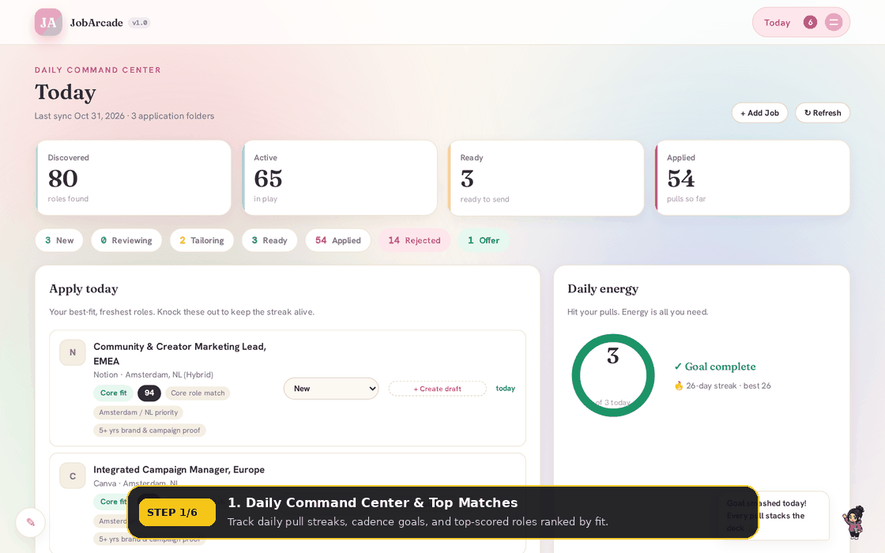
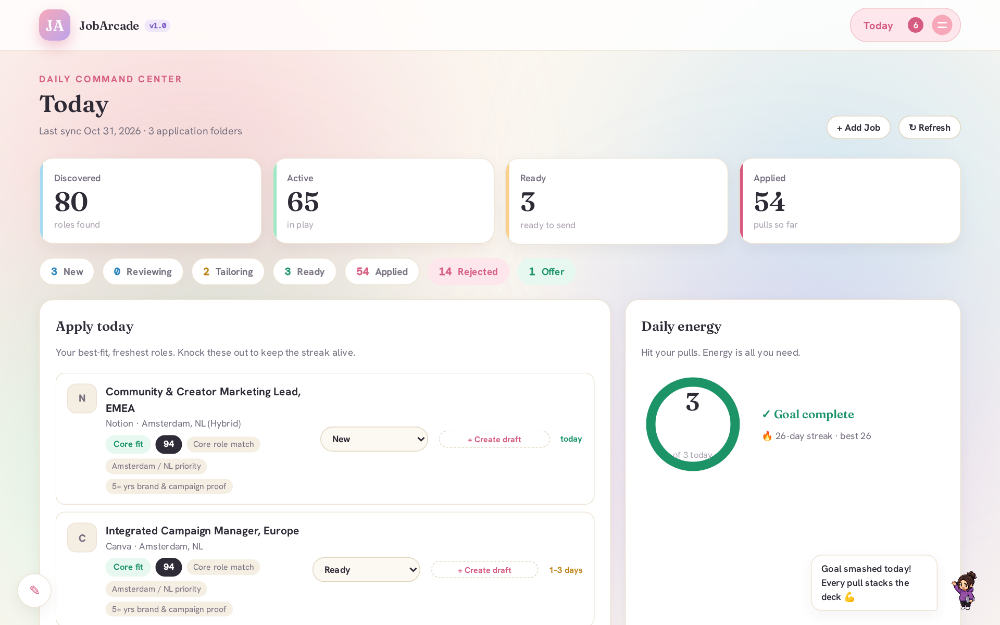
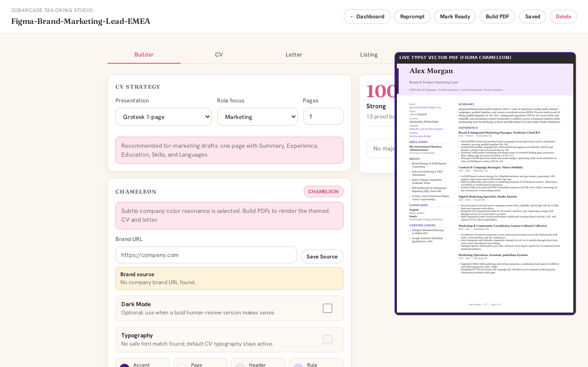
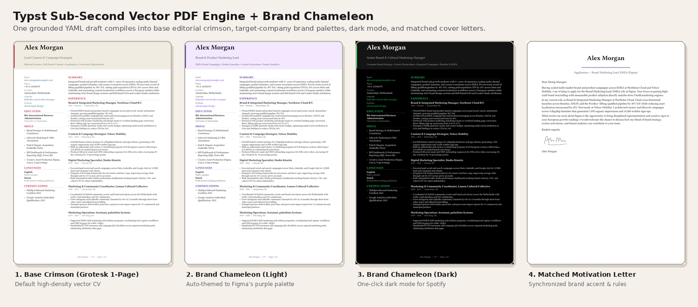
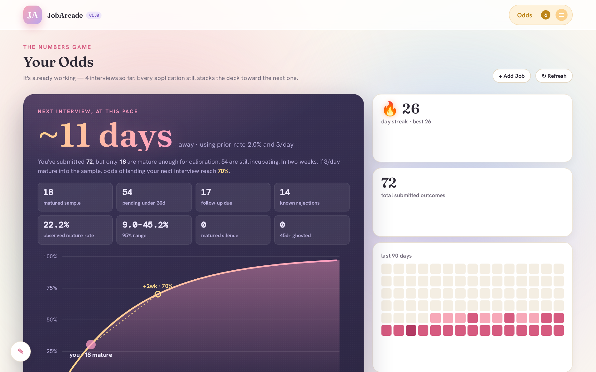
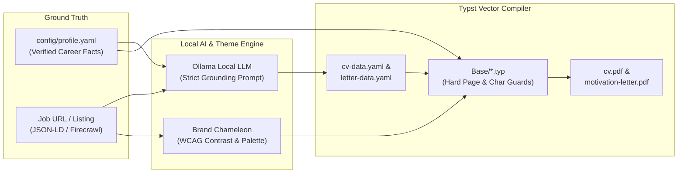

<div align="center">

# 🕹️ JobArcade

### **Turnkey, Local-First Job Application Tracker & AI CV/Cover Letter Tailoring Studio**

*Stop spending 45 minutes tweaking Word margins or letting cloud AI wrappers invent fake metrics on your resume.*  
*Tailor a grounded, brand-matched vector PDF in 60 seconds—100% locally.*

[](#)
[](#)
[](#)
[](#)
[](#)
[](#)

<br />



</div>

---

## 🎯 Why JobArcade Exists

Applying for roles in a competitive market usually forces an ugly trade-off:
1. **Spray & Pray with a Generic CV**: Fast, but gets filtered out immediately when your top bullets don't mirror the posting's terminology.
2. **Manual Tailoring in Word / Canva / Docs**: High quality, but takes 45–60 minutes per role—and a single extra line breaks your page margins.
3. **Cloud AI Resume Builders**: Fast, but **hallucinate fake metrics, skills, and employers**, sound robotic, and lock your career history behind a monthly SaaS paywall.

**JobArcade solves all three** by separating **Candidate Truth** (`config/profile.yaml`), **Role Selection & Rewriting** (local Ollama LLM), and **Deterministic Vector Typesetting** ([Typst](https://typst.app/)).

| Capability | Manual (Word / Canva) | Cloud AI Resume SaaS | 🕹️ **JobArcade** |
| :--- | :--- | :--- | :--- |
| **Hallucination Control** | Manual copy-paste | ❌ Often invents metrics & tools | ✅ **Strictly grounded** in `config/profile.yaml` |
| **Layout & Page Budget** | ❌ Breaks when a bullet wraps | ⚠️ Rigid, generic templates | ✅ **Compile-time Typst guardrails** (hard 1-page / 165-char asserts) |
| **Company Brand Matching** | ❌ Hours of manual color picking | ❌ None | ✅ **Brand Chameleon** auto-themes accent palette & dark mode |
| **Pipeline Math** | ❌ Spreadsheet guesswork | ❌ Basic status columns | ✅ **Binomial & Wilson-interval odds engine** + daily streak cadence |
| **Data Privacy & Cost** | Local files | ❌ Uploads PII to cloud; $29+/mo | ✅ **100% Local** (SQLite + local Ollama + local PDFs) |

---

> [!TIP]
> ### 🏆 Proven in Production — Field Report
> JobArcade isn't a toy weekend mockup—it was engineered during a live European marketing job hunt and retired after landing an enterprise offer **21 days ahead of its 61-day target**:
> - **92 tailored applications** shipped across 82 companies (`4.3%` application-to-interview rate in a tight market; **`25%` interview-to-offer conversion**).
> - **22 minutes** from job discovery (`09:36`) to tailored CV + motivation letter PDF submission (`09:58`) on the winning role (**Marketing Manager BeNeLux** at a multi-billion-dollar global clean-tech enterprise).
> - **The Core Finding**: 31 "stretch" applications outside core fit returned **0 interviews**. Concentrating high-density, rapidly tailored applications in `core_fit` roles produced **4 interview loops and 1 accepted offer**. Speed + relevance beat raw volume.

---

## 🖼️ Visual Tour: How It Works

### 1. Daily Command Center (`/#today`)
Start your session with a clear daily target. JobArcade ranks your unapplied `core_fit` roles at the top, tracks your **daily pull ring** and **multi-day submission streak**, and surfaces follow-up reminders when applied roles cross 14 days without a reply.



---

### 2. The 60-Second AI Tailoring Studio & Brand Chameleon (Draft view)
Click **Create Draft** on any job and your local Ollama model composes role-specific CV bullets and a 3–5 paragraph motivation letter grounded strictly in your verified career facts.

- **Deterministic CV Scrutinizer**: Flags weak proof points (missing numbers/metrics), generic clichés (*"results-driven"*, *"team player"*), or under-filled pages *before* you compile.
- **Drag-and-Drop Evidence**: Reorder roles and bullets, toggle roles on/off, and watch real-time character budget counters (`165 chars/bullet`, `600 chars/summary`).
- **Brand Chameleon**: Point Chameleon at the target company's domain (via local CSS/HTML heuristics or Firecrawl) to extract a contrast-checked brand palette and one-click Dark Mode.



---

### 3. Sub-Second Typst Vector PDF Engine (`Base/*.typ`)
No bloated LaTeX distributions or headless browser print-to-PDF hacks. JobArcade compiles **crisp, ATS-parseable vector PDFs in ~150 milliseconds** using [Typst](https://typst.app/).



- **4 Built-In Layout Variants**:
  - `grotesk_one_page` *(default)* — Modern, high-density single-page layout with a 5-role proof column and structured sidebar.
  - `compact_one_page` — Condensed single-page layout for focused profiles.
  - `classic_two_page` — Traditional two-page executive layout.
  - `enriched_two_page` — Expanded two-page layout featuring a dedicated *Selected Impact* spotlight.
- **Loud Compile-Time Guardrails**: If a bullet is too long or your copy spills onto page 2 of a 1-page variant, `Base/lib.typ` halts the build with an exact, actionable fix message instead of silently producing an ugly orphan page.

---

### 4. Maturity-Aware Probabilistic Odds (`/#odds`)
Job hunting is a stochastic pipeline with a 14-to-30-day feedback lag. Instead of vanity counters, the **Odds Engine** models your real conversion probability:
- Separates **incubating applications (<30 days)** from your **matured sample (30+ days or known outcome)**.
- Computes **Wilson score confidence intervals** on your observed response rate and projects your expected days to the next interview at your current daily cadence.
- Tracks **Ghosted (45d+)** and **Follow-up Due (14–44d)** cohorts automatically.



---

## 🧠 Architecture: Zero-Hallucination Data Flow



1. **Single Source of Candidate Truth (`config/profile.yaml`)**: Your name, contact links, education, skills, languages, certifications, and verified career facts live in one git-ignored YAML file.
2. **Constrained Ollama Prompting (`jobhunt/dashboard.py`)**: When tailoring for a job, JobArcade feeds your verified facts + the job listing into your local Ollama model with strict JSON schema validation.
3. **Plain-Text Per-Role Artifacts (`Applications/<Company>-<Role>/`)**: Every application is stored as human-readable `job-listing.md`, `cv-data.yaml`, `letter-data.yaml`, and optional `brand-theme.yaml`.
4. **Parameterized Typst Compilation (`Base/cv.typ`, `Base/letter.typ`)**: Typst merges your `config/profile.yaml` identity with the per-role YAML copy to render `cv.pdf` and `motivation-letter.pdf`.

---

## 🚀 Quickstart (Docker Compose)

```bash
git clone https://github.com/arnodecorte/jobarcade && cd jobarcade
docker compose up --build
```

Open **[http://localhost:8765](http://localhost:8765)**. A guided setup flow walks you through the rest:

1. **AI** - point JobArcade at Ollama and test the connection.
2. **Profile** - enter your details and verified career facts (written to the git-ignored `config/profile.yaml`).
3. **Style** - choose your default layout variant, accent colour, font, and light/dark mode (written to the git-ignored `config/default-theme.yaml`).
4. **Chameleon** - optionally add a Firecrawl key for company brand extraction.
5. **Goal** - set your daily application goal.

You can skip setup at any time and come back to it from the System panel.

> [!NOTE]
> **Network binding:** By default, Docker binds port `8765` to `127.0.0.1` so the dashboard is only reachable on your machine. Because the dashboard has no login, only expose it on a trusted network (for example via Tailscale, or by setting `JOBHUNT_BIND_ADDR=0.0.0.0` in `.env`).

### Ollama on the host
Install [Ollama](https://ollama.com) on your host machine (the container reaches it at `http://host.docker.internal:11434`) and pull the default model:
```bash
ollama pull qwen2.5:7b
```
Any other Ollama model works too; change it in setup or via `JOBHUNT_OLLAMA_MODEL`. To use Ollama's hosted cloud API instead, add an optional API key in the setup flow or set `JOBHUNT_OLLAMA_API_KEY`.

- **Linux note:** On Linux, Ollama binds to `127.0.0.1` by default. Set `OLLAMA_HOST=0.0.0.0` on the host Ollama service so the container can reach it via `host.docker.internal` (`docker-compose.yml` already maps `host.docker.internal:host-gateway`).

### Optional: Firecrawl for Brand Chameleon
Chameleon works with local CSS/HTML heuristics out of the box. A free [Firecrawl](https://www.firecrawl.dev) key improves brand extraction for JavaScript-heavy sites; add it in setup or set `FIRECRAWL_API_KEY`.

### Try it with demo data
```bash
# Docker
docker compose exec dashboard python -m jobhunt seed-demo           # fictional sample jobs and one draft
docker compose exec dashboard python -m jobhunt seed-demo --clear   # remove them again (or click "Remove sample data" in System / Today)

# Local install
python -m jobhunt seed-demo [--clear]
```

*(Optional)* Copy `.env.example` to `.env` to preset `JOBHUNT_BIND_ADDR`, `JOBHUNT_OLLAMA_URL`, `JOBHUNT_OLLAMA_MODEL`, `JOBHUNT_OLLAMA_API_KEY` or `FIRECRAWL_API_KEY`.

> [!NOTE]
> URL scraping and job discovery are **experimental and off by default**. Enable them with `JOBHUNT_ENABLE_SCRAPER=1` or the toggle in the System panel. Manual entry is the primary way to add jobs.

---

## 🎲 Meet Dice

Dice is the JobArcade mascot. It keeps you company on the Today view, waves at new messages, and cheers when you hit your daily goal.

---

## 📊 How the Odds Work

The odds engine estimates your chance of at least one interview after N applications as `1 - (1 - p)^N`, where `p` is the per-application interview rate.

- **Prior:** until you have enough matured applications of your own, `p` starts at a **3% prior** (adjustable between 0.5% and 8% in the odds view). As your own data matures it takes over.
- **Sources for the 3% figure:**
  - [CareerPlug 2024 Recruiting Metrics](https://www.careerplug.com/recruiting-metrics-and-kpis/) - employer data across 10M+ applications: about 3% of applicants reach an interview.
  - [Huntr 2025 Annual Job Search Trends](https://huntr.co/research/2025-annual-job-search-trends-report) - job-seeker tracker data: about 3.5% on average, from 2.7% (January) to 4.2% (November).

These are population averages, not promises; your field, seniority and tailoring quality all move the number.

---

## 🛠️ Local Development (Without Docker)

### Prerequisites
- **Python 3.11+**
- **Typst CLI (`v0.11+`)**: `brew install typst` (macOS), `winget install Typst.Typst` (Windows), or official Linux binary.
- **Ollama**: Running locally (`ollama serve`).

```bash
# 1. Create and activate virtual environment
python3 -m venv .venv
source .venv/bin/activate

# 2. Install package in editable mode
pip install -e . pytest

# 3. (Optional) pre-fill your profile by hand; otherwise the in-app setup creates it
cp config/profile.example.yaml config/profile.yaml

# 4. Validate profile, SQLite schema, and Typst compiler
python -m jobhunt validate

# 5. Launch the web dashboard
python -m jobhunt dashboard --host 127.0.0.1 --port 8765
```

---

## ⌨️ CLI Reference

JobArcade includes a full command-line interface for scripting and agentic workflows:

| Command | Description |
| :--- | :--- |
| `python -m jobhunt validate` | Verify `config/profile.yaml`, SQLite schema, and `typst` binary installation. |
| `python -m jobhunt dashboard` | Start the web dashboard server (`--host 127.0.0.1 --port 8765`). |
| `python -m jobhunt seed-demo [--clear]` | Add (or remove) fictional sample jobs and a draft for trying the dashboard. |
| `python -m jobhunt scrape-listing "<URL>"` | *Deprecated/experimental.* Extract job details from a URL; prints a deprecation notice. The scraper flag only gates the dashboard UI and API. |
| `python -m jobhunt auto-draft --limit 5` | Batch-generate Ollama CV & cover letter drafts for top-scored unbuilt roles. |
| `python -m jobhunt build --app <Folder>` | Compile `cv.pdf` and `motivation-letter.pdf` for an application folder via Typst. |

---

## 📁 Repository Structure

```text
jobarcade/
├── Base/                     # Parameterized Typst templates & compile-time guardrails
│   ├── cv.typ                # 4-variant CV layout engine
│   ├── letter.typ            # Motivation letter layout engine
│   ├── lib.typ               # Theme tokens, WCAG contrast helpers & page assertions
│   └── reference/            # Reference YAML fixtures for automated tests
├── config/
│   ├── profile.example.yaml  # Documented starter template (Alex Morgan demo profile)
│   └── profile.yaml          # Your private candidate profile (git-ignored)
├── dashboard/
│   ├── static/               # Compiled production SPA assets
│   └── web/                  # React + TypeScript + Framer Motion frontend source
├── data/                     # Local SQLite database & encrypted settings vault (git-ignored)
├── docs/assets/              # README visual tour screenshots & demo GIF
├── jobhunt/                  # Python backend & CLI
│   ├── dashboard.py          # REST API, Ollama tailoring prompts & CV scrutinizer
│   ├── profile.py            # Candidate profile loader & Typst input serializer
│   ├── brand_theme.py        # Brand Chameleon color & contrast extractor
│   ├── font_theme.py         # Brand typography resolver
│   ├── job_scrape.py         # Single-URL job extractor (JSON-LD / OpenGraph / Firecrawl)
│   ├── gmail_integration.py  # Optional OAuth inbox classifier for interview/rejection signals
│   └── database.py           # SQLite schema & lifecycle event ledger
└── tests/                    # 250+ unit, integration, and Typst compilation tests
```

---

## 🤝 Contributing & Agent-Driven Development

JobArcade is built to be extended by both humans and AI coding agents (Claude Code, Cursor, Codex, Antigravity, Copilot).  
Repository guardrails—including **strict candidate PII decoupling** and **mandatory verification (`pytest` + `jobhunt validate`)**—are pre-configured in [`AGENTS.md`](AGENTS.md), [`CLAUDE.md`](CLAUDE.md), [`.cursorrules`](.cursorrules), and [`CONTRIBUTING.md`](CONTRIBUTING.md).
