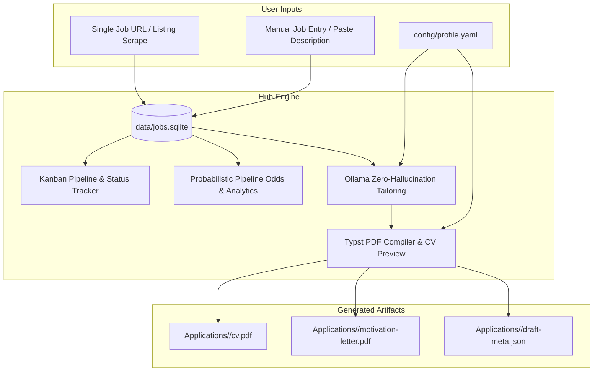

# Design Spec: Job Application & AI Tailoring Hub (Open Source / Self-Hosted Edition)

**Date**: 2026-08-31  
**Status**: Proposed / Review  

## 1. Context & Purpose

The original repository was developed as a personal job-hunt automation system. It successfully served its purpose, but in doing so, accumulated personal facts, application artifacts (CVs, motivation letters, signatures, SQLite history), and an extensive, fragile fleet of 98+ per-company careers page scrapers.

This redesign decouples the repository from any single individual, strips out the high-maintenance web-scraping fleet, and formalizes the codebase as a **turnkey, self-hosted Job Application Hub & AI Tailoring Engine** that can be published to GitHub and deployed via Docker Compose.

### Core Philosophy
- **Focus on Execution & Tailoring**: Rather than brittle web discovery, focus on what the tool does best: Kanban tracking, motivational pipeline math (probabilistic odds calculators, streaks, metrics), AI-powered CV/cover letter tailoring via Ollama, and instant PDF compilation with Typst.
- **Zero Personal Data Leakage**: All candidate facts, contact details, signatures, and history are extracted out of the engine and into configurable user files (`config/profile.yaml`).
- **Turnkey Docker Deployment**: Anyone can clone the repo, copy `profile.example.yaml` to `config/profile.yaml`, run `docker compose up -d`, and start logging and tailoring applications immediately.

---

## 2. Component Boundary & Lifecycle



---

## 3. Scope of Changes

### A. What Stays (Core Value)
1. **Web Dashboard & Kanban Pipeline**: Interactive board (`new`, `drafting`, `applied`, `interviewing`, `offer`, `rejected`), status history, notes, and activity timeline.
2. **Probabilistic Calculator & Analytics**: Application volume metrics, funnel conversion tracking, activity streak counters, and target application calculator.
3. **Single-Job URL Parser (`jobhunt/job_scrape.py`)**: Fast, lightweight extraction of job title, company, location, and description from a single pasted URL (JSON-LD -> HTML meta/OpenGraph -> optional Firecrawl fallback).
4. **Ollama AI CV & Cover Letter Tailoring**: Automated synthesis of user-provided career facts against job requirements to produce role-specific CV bullets and cover letters without hallucinations.
5. **Typst PDF Engine (`Base/`)**: Professional, mathematically balanced CV and cover letter typography (`grotesk_one_page`, `compact_one_page`, `classic_two_page`, `enriched_two_page`).
6. **CV Editor & Theme Customizer**: Web UI for tweaking copy, reordering evidence, adjusting color themes/fonts, and generating PDFs on the fly.

### B. What Gets Removed (Scraping & Legacy Discovery)
1. **Scraper Fleet (`jobhunt/adapters.py`, `jobhunt/ats.py`, `jobhunt/scrape.py`)**: Delete all bespoke company scraping adapters, Playwright headless scripts, and Paradox/Workday/Akamai crawlers.
2. **Discovery Pipeline (`jobhunt/company_candidates.py`, `jobhunt/company_sources.py`, `jobhunt/applypilot_import.py`)**: Delete bulk company resolvers, Firecrawl search crawlers, and ApplyPilot database synchronizers.
3. **Fleet Config & Scripts (`config/companies.yaml`, `batch*.py`, `daily-jobhunt*.sh`)**: Delete company scrapers registry and scheduled cron scripts.
4. **Scraper CLI Commands**: Remove `sweep`, `audit`, `discover-sites`, `resolve-candidate-urls`, and `import-applypilot` from `jobhunt/cli.py`.

### C. What Gets Scrubbed (Private Data)
1. **`Applications/*`**: Delete all candidate-specific application folders, tailored YAML files, and PDFs.
2. **`Reference/*`**: Delete personal reference CV PDFs.
3. **`data/*.sqlite`, `data/*.csv`, `data/*.md`**: Delete personal job hunt databases and markdown exports.
4. **`Base/assets/signature.png`, `signature-white.png`**: Replace with a clean generic sample signature.
5. **Hardcoded Facts in Code**:
   - Remove `ANGELICA_FACTS` string from `jobhunt/dashboard.py` and `jobhunt/cli.py`.
   - Remove hardcoded `#let NAME`, `#let CONTACT`, `#let SKILLS`, `#let LANGUAGES`, `#let EDUCATION`, `#let CERTS` from `Base/cv.typ` and `Base/letter.typ`.

---

## 4. Configuration & Candidate Profile Architecture

### `config/profile.yaml` (New Core Config)
A unified, candidate-agnostic configuration schema:

```yaml
candidate:
  name: "Alex Morgan"
  tagline: "Product Marketing & Growth Strategist"
  contact:
    email: "alex.morgan@example.com"
    phone: "+31 6 12345678"
    location: "Amsterdam, Netherlands"
    linkedin: "linkedin.com/in/alex-morgan"
    linkedin_url: "https://www.linkedin.com/in/alex-morgan/"
    portfolio: "alexmorgan.design"
    portfolio_url: "https://alexmorgan.design"
  
  # Master facts fed into Ollama prompt for zero-hallucination tailoring
  career_facts: |
    - Senior Marketing Specialist, TechCorp (SaaS), Amsterdam, 2023-Present: Owned B2B demand gen, ran paid acquisition campaigns, managed content calendars, increased inbound leads by 35%.
    - Growth Marketing Coordinator, StartupX, 2021-2023: Built lifecycle email automations in HubSpot, executed A/B tests on landing pages, boosted trial-to-paid conversion by 18%.
    - Marketing Assistant, Agency Y, 2019-2021: Produced social media assets, drafted blog posts, and reported campaign analytics.

  skills:
    - "Brand Strategy & Consistency"
    - "Lifecycle Marketing & CRM Automation"
    - "Paid & Organic Acquisition (LinkedIn, Meta)"
    - "Data Analytics (SQL, Power BI, Google Analytics)"
    - "Content Production (Figma, Canva, Copywriting)"

  languages:
    - ["English", "Native speaker"]
    - ["Dutch", "Professional working proficiency"]

  education:
    - deg: "BSc International Business Administration"
      school: "University of Amsterdam"
      notes:
        - "Specialization in Digital Marketing & Consumer Behavior"

  certifications:
    - "HubSpot Inbound Marketing Certified, 2023"
    - "Google Analytics Individual Qualification, 2022"

target_preferences:
  target_roles:
    - "Marketing Manager"
    - "Product Marketing Manager"
    - "Growth Marketing Specialist"
    - "Content Strategist"
  target_locations:
    - "Amsterdam"
    - "Rotterdam"
    - "Utrecht"
    - "Remote"
```

A companion file `config/profile.example.yaml` will be checked into git. If `config/profile.yaml` does not exist on startup, the system loads `config/profile.example.yaml` as default.

---

## 5. Typst Template Decoupling

In `Base/cv.typ` and `Base/letter.typ`:
1. The templates will load the candidate profile via Typst YAML import (`yaml(sys.inputs.profile)`) or fall back to sensible defaults.
2. The user's name, contact list, skills, languages, education, and certifications will render dynamically from the loaded profile.
3. The signature image in `Base/assets/signature.png` will only render if the file exists; otherwise it cleanly renders the candidate's formatted name text.

---

## 6. Docker & Deployment Architecture

### Updated `docker-compose.yml`
```yaml
services:
  jobhunt:
    build: .
    container_name: jobhunt-hub
    restart: unless-stopped
    ports:
      - "8765:8765"
    environment:
      - JOBHUNT_OLLAMA_URL=http://host.docker.internal:11434
      - JOBHUNT_OLLAMA_MODEL=qwen2.5:7b
      - FIRECRAWL_API_KEY=${FIRECRAWL_API_KEY:-}
    volumes:
      - ./config:/app/config
      - ./data:/app/data
      - ./Applications:/app/Applications
    extra_hosts:
      - "host.docker.internal:host-gateway"
```

### Slimmed Down `Dockerfile`
- Remove heavy Playwright / Google Chrome / Xvfb system packages and browser dependencies.
- Retain Python 3.11, Typst CLI (for PDF generation), and SQLite.
- Much smaller image footprint and faster build time.

---

## 7. Testing & Verification Plan

1. **Profile Loading Tests**: Verify `profile.yaml` parsing and fallback handling when fields are missing.
2. **Dynamic Typst Build Tests**: Verify `typst compile` succeeds for all variants (`grotesk_one_page`, `enriched_two_page`, etc.) using dynamic profile inputs.
3. **Single-Job URL Scrape Tests**: Test single listing extraction (JSON-LD and HTML heuristics) with live/mock HTTP responses.
4. **Ollama Draft Generation Tests**: Verify draft pack generation uses the injected candidate profile facts.
5. **Dashboard Endpoints**: Verify manual job creation, status transitions, analytics/probabilistic calculations, and PDF generation endpoints.
6. **Docker Build Verification**: Ensure `docker compose build` succeeds cleanly without obsolete scraper dependencies.
